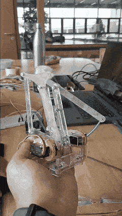
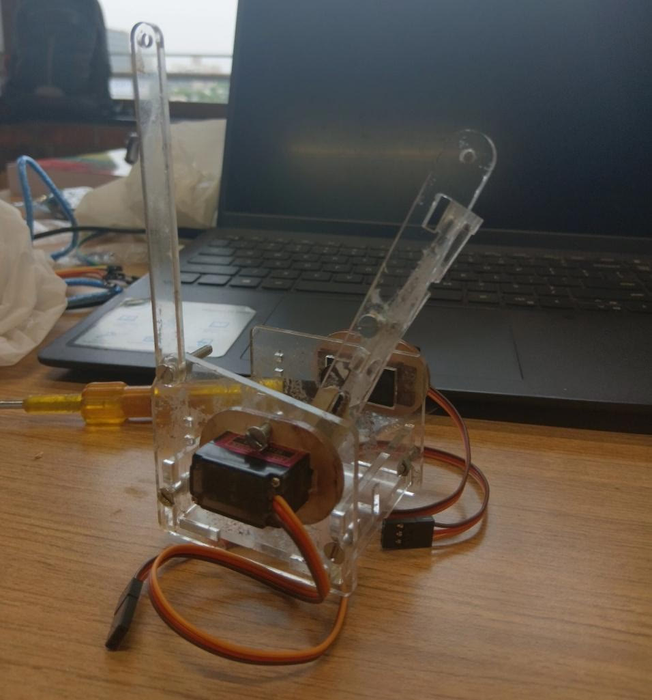
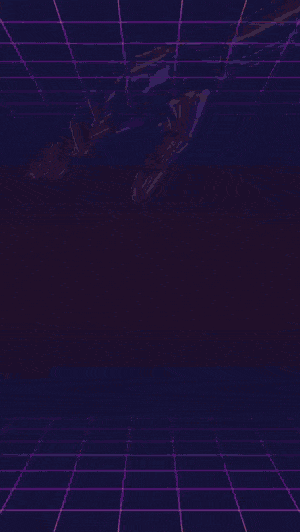
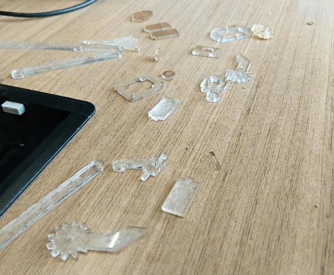
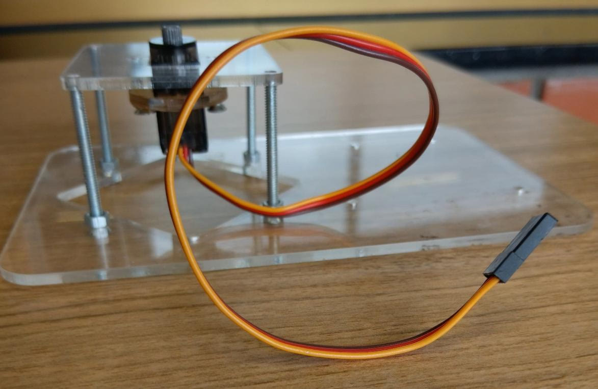
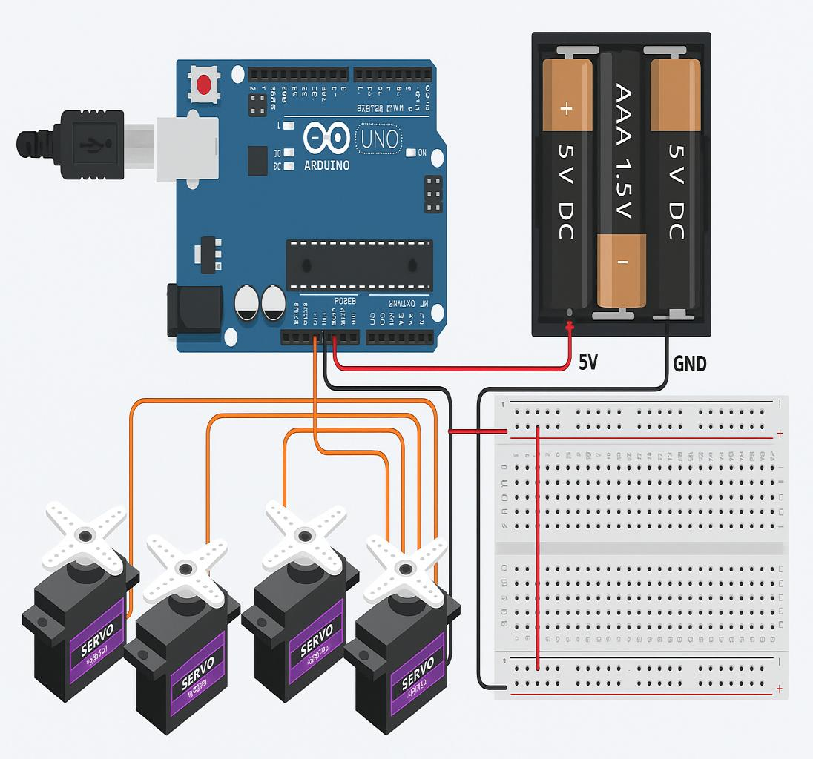
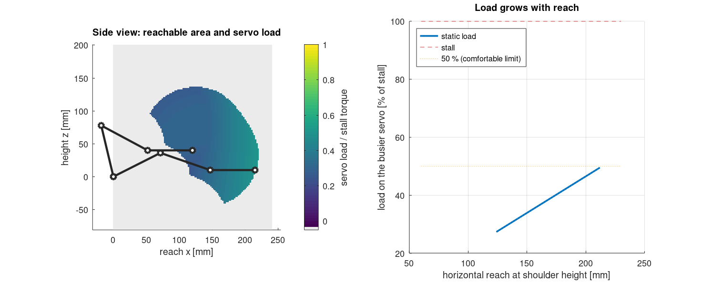

# MeArm Robotic Arm

A 4-degree-of-freedom desktop robot arm built from laser-cut **4 mm acrylic** and four **MG90S** servos, controlled by an **Arduino Uno**. We built it in July 2025 as team **Byte & Bolt** in the 15-day *SAE × Robonix* summer robotics challenge at Ahmedabad University.

The arm is based on the open-source **[MeArm](https://github.com/MeArm/MeArm)** by Benjamin Gray and Jack Howard. The original design is theirs, and our changes are listed below. See [Credits](#credits).

| | |
|---|---|
|  |  |
| <sub>The finished arm running through its joints.</sub> | <sub>Assembly on the bench.</sub> |

## What we built

- **Structure:** MeArm parts cut from 4 mm clear acrylic instead of the standard 3 mm, for a stiffer arm. Slots and holes were sized for the thicker sheet: M3 holes opened to about 3.2 mm, and servo pockets sized to the MG90S body.
- **Additions to the original:**
  - a mounting point for the Uno on the base
  - pads under the base for grip
  - a gripper reinforced at its high-stress joints
- **Electronics:** an Uno driving four servos on PWM pins (base D3, shoulder D5, elbow D6, gripper D9). The servos run from a separate 5 V supply with a common ground.
- **Control:** open loop. A timed sequence of servo angles produced a pick-and-place routine, with potentiometer control as an option.
- **Simulation first:** we laid out and tested the circuit in Tinkercad, sweeping each servo, before wiring the real arm.

| Laser cutting | Cut parts | Base with servo | Tinkercad circuit |
|---|---|---|---|
|  |  |  |  |

The full build story, from sheets of acrylic to the final demo, is in [docs/journey.md](docs/journey.md).

## How it went

| Test | Result |
|---|---|
| Joint motion | All four servos responded smoothly; base rotation was slightly jerky on fast turns |
| Structure | The 4 mm acrylic held up with little flex under light loads |
| Gripper | Held light objects such as paper and a foam cube |
| Pick-and-place | Moved a foam cube from one side of the table to the other in about 15–20 s |
| Heat | Servos warmed up over long sessions, so we took cooling breaks |

**Problems we hit, and the fixes:**

| Problem | Cause | Fix |
|---|---|---|
| Arduino kept resetting | All four servos were powered from the Uno's 5 V pin | Separate 5 V supply, grounds tied together |
| One servo jittered | A loose ground connection | Re-made the ground |
| Parts didn't fit first time | Laser kerf on the 4 mm sheet | Trimmed slots, filed the gripper for full travel |
| Gripper flexed under load | Thin acrylic at the high-stress points | Reinforced with hot glue |
| Elbow struggled at full reach | The servo is heavily loaded with the arm stretched out | See the analysis below |

## After the challenge: kinematics and smoother control

The challenge version moved joint by joint with fixed angles and delays. The next step was to control the gripper by **position** rather than by servo angles, and to understand why the arm struggled at full reach. These parts were added afterwards and are new code written for this repository.

**Kinematics ([`matlab/`](matlab/)):**
- The MeArm's parallel linkage holds the gripper level and drives the forearm angle directly. That makes the inverse kinematics two triangles plus a base rotation.
- The MATLAB toolbox maps the reachable area under the joint and linkage limits, and estimates the static load on the shoulder and elbow servos.
- With the arm stretched out level, the busier servo carries about **half of the MG90S stall torque** from gravity alone. Add acceleration and a sagging supply, and that fits the elbow trouble and jitter we saw at full reach.



**Firmware ([`firmware/mearm_ik/`](firmware/mearm_ik/)):**
- You send the gripper a position in millimetres, for example `P 150 -60 -10`.
- The arm checks the whole straight-line path against its joint and linkage limits before moving, then follows it with an eased start and stop instead of jumping between angles.
- `D` runs a pick-and-place demo; `G 1` and `G 0` close and open the gripper.

**Cross-checked:** the MATLAB and C++ inverse kinematics agree on every test point, and CI checks both on every push.

**Not yet run on the arm:** the link lengths in [`config/arm.json`](config/arm.json) are the nominal MeArm values, and the joint limits are estimates. Both need measuring and calibrating on the real arm before the IK firmware is used.

## Repository

```
config/arm.json        link lengths, joint limits, servo calibration (one source for MATLAB and firmware)
matlab/                IK / FK, workspace and servo-load analysis, tests
firmware/mearm_ik/     Arduino sketch: position control with limit checks and smooth motion
firmware/test/         PC tests of the firmware kinematics against the MATLAB table
docs/journey.md        how the build went, step by step
media/                 photos, GIFs and videos from the build
tools/                 generates firmware/mearm_ik/config.h from config/arm.json
```

```bash
# MATLAB / Octave
cd matlab && octave --eval run_all
# firmware tests on a PC
g++ -std=c++17 firmware/test/test_native.cpp firmware/mearm_ik/kinematics.cpp -o test && ./test matlab/output/ik_table.csv
```

## Credits

This was a team project. Full credits and licences are in [CREDITS.md](CREDITS.md).

- **Team Byte & Bolt (Group A):** Aamna Khan, Aryan Abhishekh, Khushi Shah, Nikkesh Parekh
- **Mentor:** Dev Shah
- **Faculty:** Prof. Maryam Kaveshghar
- **Organisers:** the Robotics Club of Ahmedabad University and the SAE student chapter (*SAE × Robonix*, July 2025)
- **Original MeArm design:** Benjamin Gray and Jack Howard (phenoptix, now MeArm Robotics). The hardware is open source under CC BY-SA.

The code and documentation written for this repository are under the [MIT License](LICENSE). The MeArm hardware design remains under its own CC BY-SA licence; see [CREDITS.md](CREDITS.md).
