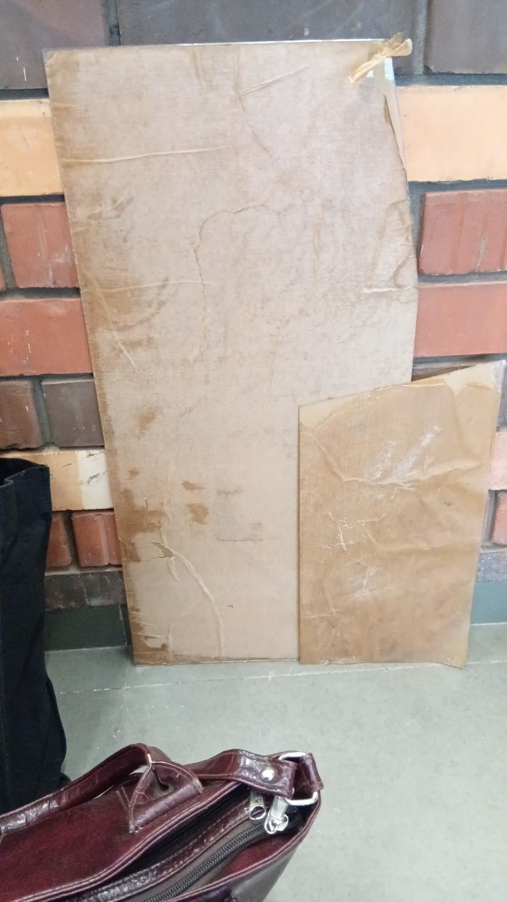
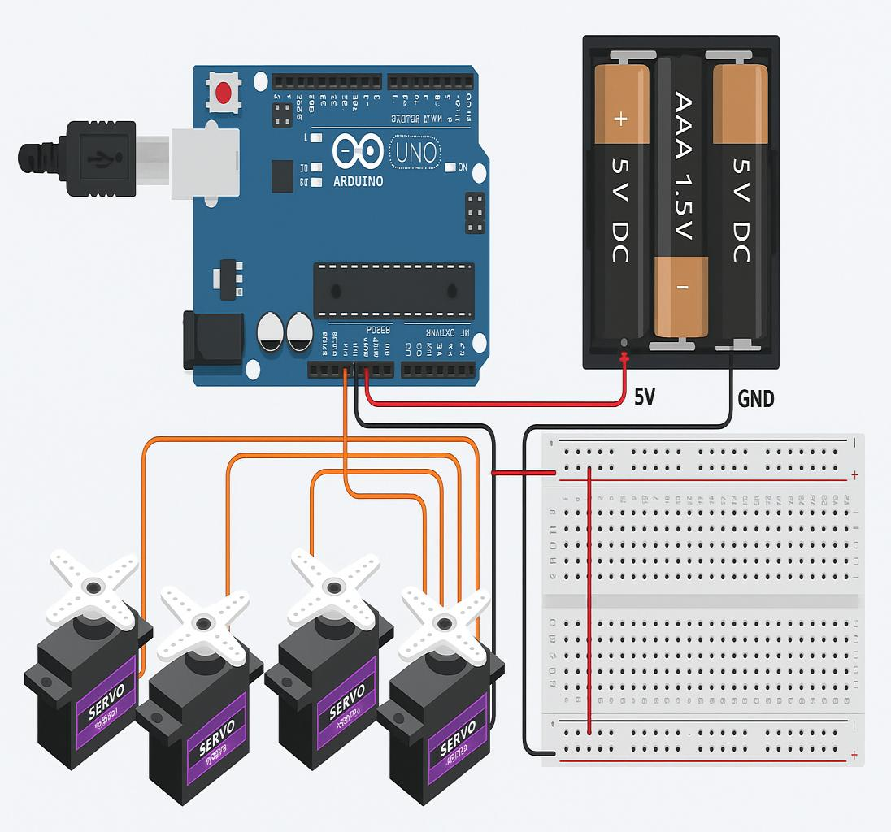
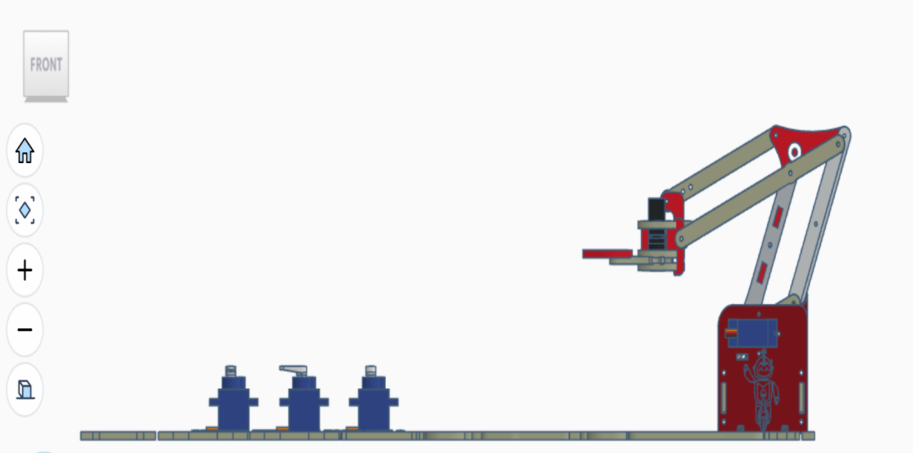
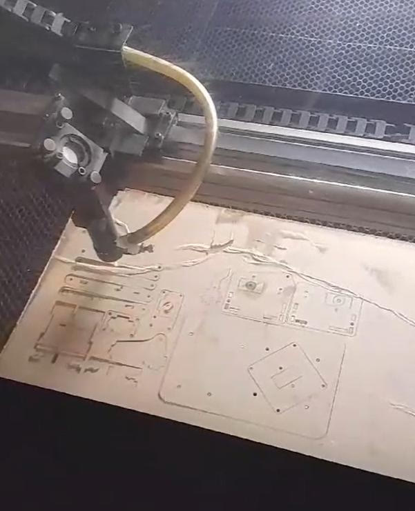
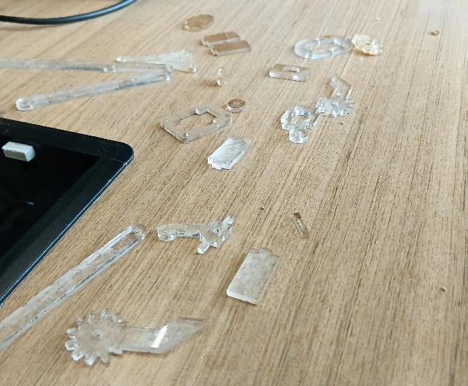
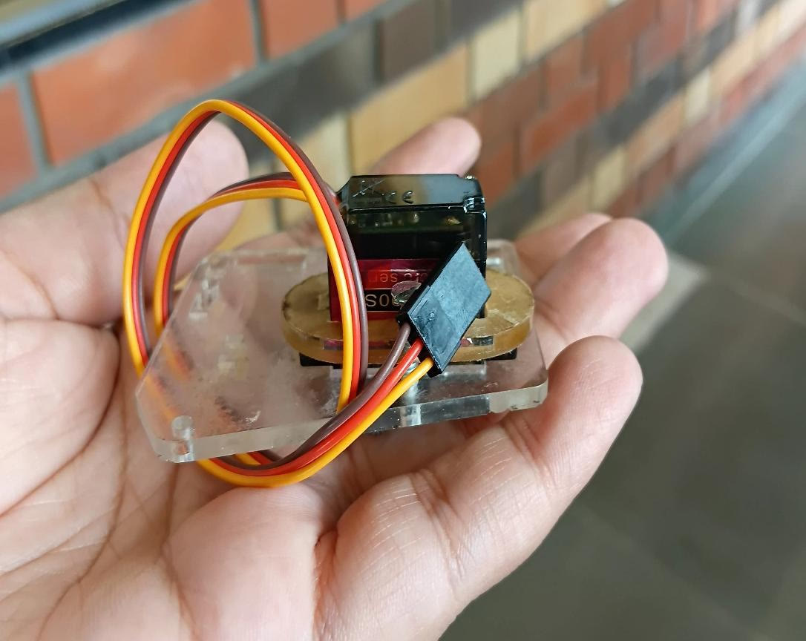
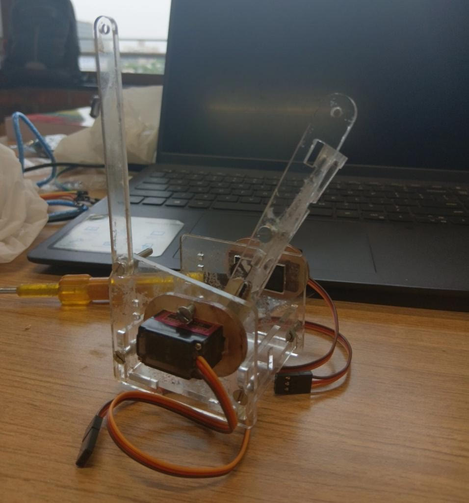

[← Back to README](../README.md)

# Build journey

*SAE × Robonix* was a 15-day team challenge that started on 15 July 2025. Teams were judged on problem analysis, design, simulation, the working model and the report. Our team, Byte & Bolt, chose the robotic arm. We worked in five phases.

## 1. Choosing the design

We wanted an arm that was small and cheap, and that we could finish and understand within two weeks. We picked the open-source MeArm (Benjamin Gray and Jack Howard) because:

- it is well documented
- its parts cut from a single sheet
- it is designed around an Arduino and hobby servos

Before settling the plan, we read through several builds, the MeArm guides and the servo specifications.

## 2. Parts

- **Material change:** the main departure from the original was the material. We used **4 mm acrylic** instead of the usual 3 mm, for stiffness. So every slot, servo pocket and screw length had to be checked against the thicker sheet.
- **Bill of materials:**
  - four MG90S metal-gear servos
  - an Arduino Uno
  - a 5 V supply (a power bank during testing)
  - jumper wires and servo extensions
  - M3 screws and nuts in several lengths

## 3. Simulating first

We built the circuit in **Tinkercad** before touching the real servos: an Uno, a supply, four servos and a sweep sketch. This checked the wiring, the direction each servo turns and its range. We also laid the arm out in 3D to see the joints move together.

| Circuit | 3D layout |
|---|---|
|  |  |

## 4. Cutting and assembling

- **Cutting:** the parts were laser-cut, the protective film peeled off, and the edges sanded where the parts rotate against each other.
- **Assembly order:** base, then shoulder, elbow and gripper.
- **Centring the servos:** each servo was set to 90° before its horn went on, so its neutral position matched the arm's.
- **Fixes during assembly:**
  - Laser kerf left some slots tight, so we trimmed them.
  - Loose joints got extra washers.
  - The gripper's high-stress points were reinforced with hot glue.

| Cutting | Parts | Base | Assembly |
|---|---|---|---|
|  |  |  |  |

## 5. Wiring, calibration and testing

- **Calibrating:** we wired the servos and tested them one at a time, then adjusted each one's angle range in code so it couldn't drive into the frame.
- **Power:** the first attempt powered everything from the Uno's 5 V pin, and the board reset whenever several servos moved at once. A separate 5 V supply with a shared ground fixed it.
- **Jitter:** one servo jittered because of a poor ground connection, which we re-made.
- **Demo:** the final run picked a foam cube up on one side of the table and set it down on the other, in about 15 to 20 seconds.

Videos: [arm test 1](../media/videos/arm-test-1.mp4) · [arm test 2](../media/videos/arm-test-2.mp4) · [laser cutting](../media/videos/laser-cutting.mp4)

## What we took away

- **Integration:** even a small arm needs the mechanics, electronics and code to work together. Most of our problems were at the boundaries between them: power, grounding and fit.
- **Measuring:** the material choice and the cutting tolerances mattered as much as the code.
- **Next steps:**
  - control by position instead of servo angles (inverse kinematics)
  - smoother motion
  - wireless or joystick control
  - a stronger gripper

The first two are now in this repository; see the [README](../README.md#after-the-challenge-kinematics-and-smoother-control).
